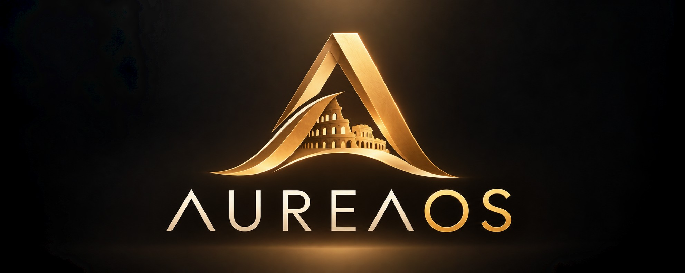

  

# AureaOS

**Take the simplicity people love in operating systems, and shape it to fit Linux.**

AureaOS is a Linux distribution project built on Debian GNU/Linux 13 (Trixie) for `amd64` (x86-64). Its first release is **AureaOS Roma 1.0**. The project aims to make Linux feel natural, coherent, and welcoming through a GUI-first, Wayland-first desktop experience.

## Project status

The repository contains an early Debian bootstrap script, package manifests, and design resources. The script creates a minimal, terminal-only Debian root filesystem; this is a development artifact, not an installable AureaOS image. The desktop UI, AureaOS applications, installer, and graphical system tools are planned and have not yet been implemented. Package resolution for the full profile and a bootable image still need validation.

Visual tokens, themes, icons, illustrations, and wallpapers are present as design assets. Their presence does not mean a working desktop or shared application library exists.

## Product direction

AureaOS is planned as a coherent desktop with graphical workflows for everyday use. The terminal remains available for advanced users and system work. The system is intended to support local accounts without requiring a cloud account.

Planned components include:

- **Aurea Desktop:** desktop shell and window management.
- **Quaero:** global search for applications, files, folders, and settings.
- **Fides:** graphical file manager.
- **Aurea Store:** graphical application discovery and management, planned around Flatpak and Flathub.
- **Aurea Update:** system updates for AureaOS components, separate from Debian base updates and application updates.
- **Aurea Backup** and **Aurea Recovery:** planned backup and recovery tools.

These names describe planned work, not available features. Scope and implementation choices may change as the project develops.

## Technical direction

- Debian GNU/Linux 13 (Trixie), `amd64`.
- GUI-first and Wayland-first desktop direction.
- Separate update channels for the Debian base and AureaOS-specific system components.
- Flatpak and Flathub planned for application distribution.
- Open-source and proprietary third-party components may be considered, subject to technical, licensing, and distribution review.

## Documentation

- [Vision](VISION.md) — goals and intended user experience.
- [Philosophy](PHILOSOPHY.md) — project principles.
- [Product experience](PRODUCT_EXPERIENCE.md) — planned workflows and components.
- [Technology principles](TECHNOLOGY.md) — technical direction and selection criteria.
- [Roadmap](ROADMAP.md) — development status and priorities.
- [Initial architecture](docs/architecture/INITIAL-ARCHITECTURE.md) — system layers and open decisions.
- [Debian base](docs/architecture/DEBIAN-BASE.md) — current bootstrap implementation and limitations.
- [Debian package manifests](debian/packages/README.md) — package groups and profile status.
- [Planned applications](docs/product/PLANNED-APPLICATIONS.md) — candidate first-party applications.
- [Planned system tools](docs/product/PLANNED-SYSTEM-TOOLS.md) — printer, scanner, and resource-monitor requirements.
- [AureaOS Human Interfaces](docs/human-interfaces/README.md) — design resources and planned shared UI library.
- [Contributing](CONTRIBUTING.md) — ways to contribute.
- [License](LICENSE) — license for original AureaOS work.

## Guiding idea

**“La tecnologia è bella quando c’è e non si vede.”**

*Technology is beautiful when it is there, but you barely notice it.*

The interface should help people do what they want without getting in their way.

## License

Original AureaOS work is released under the GNU General Public License version 3.0 (GPL-3.0), unless stated otherwise. Third-party software and assets remain subject to their own licenses and terms.
