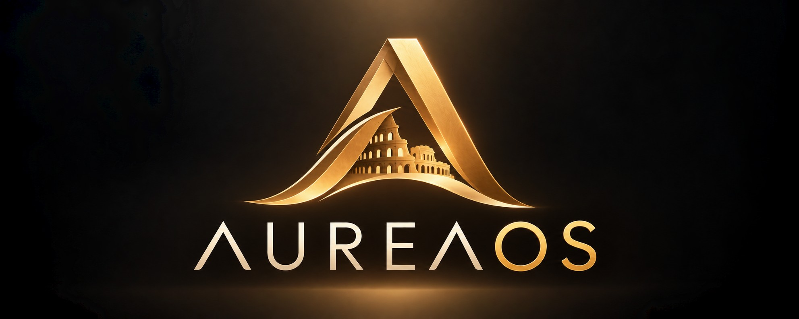

  

# AureaOS

**Take the simplicity people love in operating systems, and shape it to fit Linux.**

AureaOS is a Linux operating-system project with a simple ambition: make Linux feel natural, elegant, coherent, and welcoming to everyone. The project’s original code is open source; the finished system may also integrate third-party proprietary software or firmware when technically justified and legally distributable.

It is being designed as a complete desktop experience, where the system, applications, settings, and everyday workflows feel like parts of one whole.

## Our Vision

We believe an operating system should adapt to people, not the other way around.

AureaOS aims to combine the openness and flexibility of Linux with the simplicity, consistency, and attention to detail that make technology enjoyable to use.

The goal is not to hide Linux's capabilities, but to make them accessible without requiring users to understand its complexity.

## What AureaOS Stands For

- **Simplicity:** everyday tasks should be straightforward and intuitive.
- **Consistency:** the desktop, applications, settings, and system tools should share one coherent design.
- **Elegance:** thoughtful typography, restrained animations, translucent surfaces, and warm visual details.
- **User choice:** a system designed to respect users and avoid a mandatory cloud account; individual third-party components retain their own licenses and terms.
- **Accessibility:** a welcoming experience for beginners and experienced users alike.
- **Reliability:** updates, recovery, and system maintenance should be understandable and dependable.

## A Desktop Designed as One Experience

AureaOS is planned around a set of integrated components:

- **Aurea Desktop:** the desktop environment and window management experience.
- **Quaero:** a global search for applications, files, folders, and settings.
- **Fides:** a simple, coherent file manager.
- **Aurea Store:** a graphical application store built around Flatpak and Flathub.
- **Aurea Update:** a clear and accessible system update manager.
- **Aurea Backup:** tools for protecting personal data.
- **Aurea Recovery:** tools for recovering a system when something goes wrong.

These are planned components, not yet implemented features. Their design and scope will evolve as development progresses.

## Built on Linux

AureaOS will use Debian as its technical foundation.

Debian provides the foundation; AureaOS will build its own identity and user experience on top of it.

The initial target is x86-64 hardware, with a focus on automatic hardware detection, straightforward installation, and a desktop that works well without requiring the terminal for ordinary tasks.

A local user account will be available without requiring a mandatory cloud account. Additional options, including biometric login, may be supported where compatible hardware and software allow it.

## First Release: AureaOS Roma 1.0

The first planned release is **AureaOS Roma 1.0**.

Future releases may take their names from other Italian cities, reflecting the project's roots and identity.

The initial goal is to build a reliable, installable system with a coherent desktop experience, essential system tools, documentation, and a clearly defined scope of supported hardware.

## Documentation

Explore the project's vision, philosophy, technical direction, and development plans:

- [Vision](VISION.md) — the goals and intended experience of AureaOS.
- [Philosophy](PHILOSOPHY.md) — the ideas and design principles that define the project's identity.
- [Technology Principles](TECHNOLOGY.md) — the technical direction and criteria for choosing technologies.
- [Roadmap](ROADMAP.md) — the planned development phases and priorities.
- [Contributing](CONTRIBUTING.md) — how to participate, share ideas, and contribute.
- [License](LICENSE) — the GNU General Public License version 3.0.

Project artwork and visual assets are available in the [assets directory](assets/).

## Our Guiding Idea

**“La tecnologia è bella quando c’è e non si vede.”**

*Technology is beautiful when it is there, but you barely notice it.*

Technology should feel natural. The interface should help people accomplish what they want, without getting in their way.

## Project Status

AureaOS is currently in its planning and early setup stage. The project is open to discussion, ideas, contributions, and collaboration.

Features described in this README represent the project's direction and may change as development progresses.

## License

AureaOS's original work is released under the GNU General Public License v3.0 (GPL-3.0), unless otherwise stated.

Third-party software remains subject to its respective licenses.

---

**Rome wasn't built in a day, and neither will AureaOS be. Let's build it together, one step at a time.**
